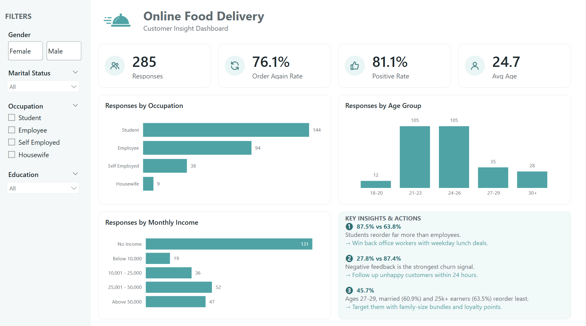

# Who Orders Again? Online Food Delivery Customer Analysis

Power BI dashboard yang menganalisis survey customer online food delivery di Bengaluru untuk menjawab satu pertanyaan bisnis: **segmen customer mana yang paling mungkin order lagi, dan apa yang bisa dilakukan untuk segmen yang paling rawan churn?**

**Tools:** Power BI Desktop, DAX, Python (pandas) untuk data cleaning (`build.py`)
**Data:** [Online Food Ordering Dataset](https://www.kaggle.com/datasets/srisyra02/online-food-ordering-dataset), 388 respon survey, 13 kolom




---

## 1. Data cleaning

| Masalah | Penanganan |
|---|---|
| Nilai `"Negative "` punya trailing space | Di-trim jadi `Negative` |
| Kolom ke-14 tanpa nama | Dihapus, isinya identik dengan `Output` di semua baris |
| Typo label (`Self Employeed`, `House wife`) | Dirapikan jadi `Self Employed`, `Housewife` |
| 103 baris duplikat persis | Diberi flag `IsDuplicate`, semua measure exclude by default (285 respon unik) |
| `Customer Type` ternyata 100% ditentukan oleh family size (1 = New, 2-3 = Regular, 4-6 = Frequent) | Tidak dipakai sebagai indikator perilaku order |

## 2. Data model

Star schema dengan 1 fact table dan beberapa dimension:

```
DimGender ──┐                 ┌── DimOccupation
DimMarital ─┤                 ├── DimIncome
DimAgeGroup ┴─ FactResponse ──┴── DimEducation
```

- Semua relasi 1:* single direction ke `FactResponse`
- Kolom label di setiap dim di-sort pakai `SortOrder` (income, education, dan age group urut logis, bukan alfabet)
- Semua measure ada di tabel `_Measures`, lihat `measures.dax`

## 3. Halaman dashboard

Kedua halaman punya sidebar filter yang sama (Gender, Marital Status, Occupation, Education) dan slicer-nya di-sync, jadi filter yang dipilih di satu halaman ikut kebawa ke halaman lain.

**Page 1: Overview**
- KPI: Responses, Order Again Rate, Positive Rate, Avg Age
- Bar: Responses by Occupation, by Age Group, by Monthly Income
- Panel Key Insights & Actions: 3 temuan utama, masing-masing dengan angka, penjelasan, dan rekomendasi aksi

**Page 2: Who Orders Again?**
- KPI: Responses, Order Again Rate, Order again rate kalau feedback positif vs negatif
- Bar: Order Again Rate by Occupation, by Age Group, by Marital Status, by Monthly Income

## 4. Key insights (285 respon unik)

1. **Baseline tinggi.** 76.1% customer order lagi dan 81.1% kasih feedback positif, jadi yang menarik adalah segmen yang jatuh di bawah rata-rata.
2. **Student paling loyal.** Order again rate student 87.5%, Employee cuma 63.8%.
3. **Feedback adalah sinyal churn terkuat.** Feedback positif: 87.4% order lagi. Feedback negatif: cuma 27.8%.
4. **Usia 27-29 paling rawan churn (45.7%)**, jauh di bawah usia 21-23 (88.6%).
5. **Married lebih jarang order lagi daripada single** (60.9% vs 84.7%).
6. **Makin tinggi income, makin jarang order lagi.** No income 85.5%, sedangkan 25,001-50,000 cuma 63.5% dan di atas 50,000 63.8%.

Poin 4 sampai 6 kemungkinan menggambarkan segmen yang sama: orang yang sudah kerja, menikah, dan punya lebih banyak alternatif (masak sendiri, dine-in).

**Rekomendasi**
- Tarik balik pekerja kantoran dengan promo makan siang di hari kerja.
- Follow up customer dengan feedback negatif dalam 24 jam, karena ini sinyal churn paling jelas.
- Targetkan usia 27-29, married, dan income menengah ke atas dengan paket keluarga dan loyalty points.

**Keterbatasan:** sampel kecil (285 respon unik) dan didominasi student usia 21-26, jadi insight lebih tepat dibaca sebagai indikasi, bukan kesimpulan statistik.

## 5. File di repo

| File | Isi |
|---|---|
| `food-delivery.pbix` | Dashboard Power BI |
| `data/online food delivery dataset.csv` | Raw data dari Kaggle, belum dibersihkan |
| `build.py` | Script Python (pandas) untuk cleaning dan bikin star schema |
| `online_food_model.xlsx` | Data yang sudah dibersihkan, dalam bentuk star schema |
| `measures.dax` | Semua DAX measure |
| `theme_teal.json` | Theme warna dashboard |
| `icons/` | Icon untuk KPI card dan header |

## 6. Cara reproduce

0. (Opsional) `pip install pandas openpyxl`, lalu `python build.py` untuk generate ulang `online_food_model.xlsx` dari raw data
1. Get Data > Excel > `online_food_model.xlsx`, centang semua sheet kecuali README
2. Model view: buat relasi dim ke `FactResponse` sesuai bagian 2 (matikan auto-detect relationship supaya kolom `SortOrder` antar dim tidak ikut terhubung)
3. Set `Sort by column` = `SortOrder` di tiap dim
4. Buat tabel `_Measures`, paste measure dari `measures.dax`
5. View > Themes > Browse for themes > `theme_teal.json`
